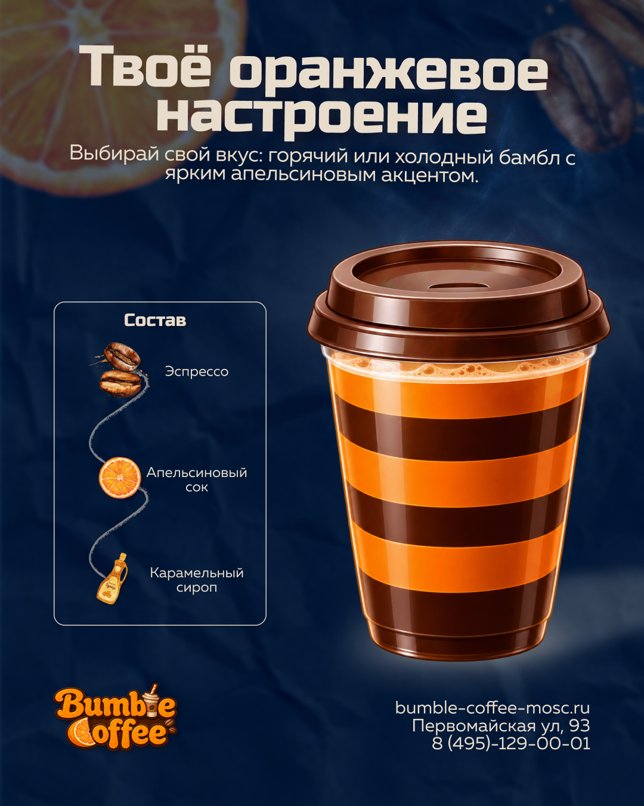
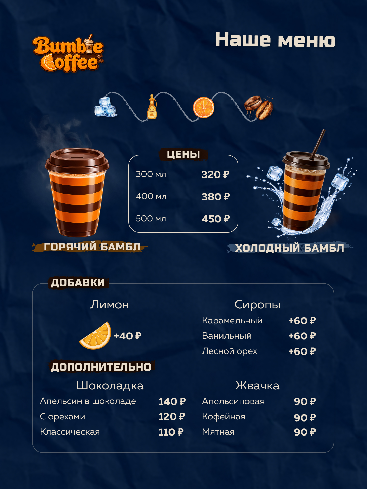
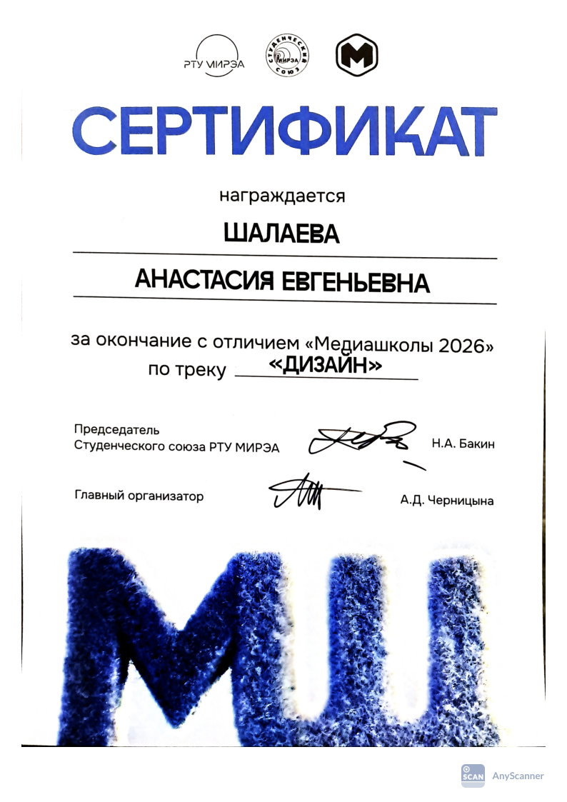

## Начинающий фронтенд разработчик

Всех приветствую! Меня зовут Настя, и я обучаюсь на 2 курсе РТУ МИРЭА по специальности "Фуллстек разработка". Данный аккаунт создала недавно, но надеюсь красиво и интересно наполнить его в дальнейшем.

**Владею навыками:**
HTML, CSS, JS, Figma, Python, C++, Git.

### Design

**Медиашкола 2026 | РТУ МИРЭА**

Работа, выполненная в рамках обучения
по треку «Дизайн».

Cертификат с отличием

**Рандомные факты из жизни:**

- Поступала на международный бакалавриат по бизнесу и экономике ВШЭ, но отчислилась спустя месяц, с нуля подготовилась к ЕГЭ по информатике на 100 и переехала в Москву
- Хочу жить на Юге, путешествовать по Европе
- Учу английский для себя
- Фанат реалити шоу и американо без сахара
- Мечтаю покататься на мотоцикле и пробежать марафон
- Романтик в душе, реалист в жизни
